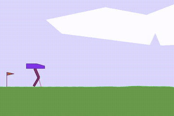
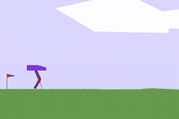
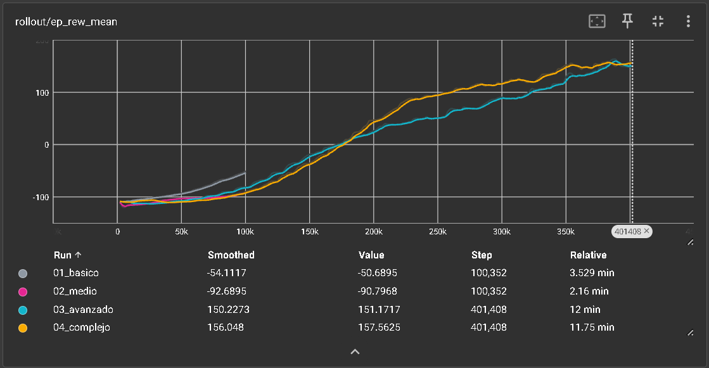

# Enseñando a un robot a caminar — PPO en BipedalWalker

[English](README.md) · **Español**

> **Proyecto académico** · Máster en Ciencia de Datos e Inteligencia Artificial (MCDIA) · Afi Escuela · Curso 2025-26
> Módulo: *Reinforcement Learning* · Trabajo en grupo con Said Daniel Huarita Mollo


<p align="center">
  
  <br><em>Mejor agente: recompensa media de 300,5 ± 1,0, por encima del umbral de 300 puntos que marca el entorno como resuelto</em>
</p>

## Objetivo

Entrenar a un robot bípedo simulado para que camine sobre un terreno irregular de la forma más eficiente posible usando **Proximal Policy Optimization (PPO)**, y estudiar cómo afectan los principales hiperparámetros al aprendizaje.

## Entorno

[BipedalWalker-v3](https://gymnasium.farama.org/environments/box2d/bipedal_walker/) (Gymnasium, Box2D): **24 observaciones** (ángulo y velocidad del cuerpo, posición y velocidad de las articulaciones, contacto de las piernas con el suelo y 10 lecturas de un lidar) y **4 acciones continuas** (par motor en caderas y rodillas). El robot gana recompensa al avanzar, paga un pequeño coste por aplicar fuerza y pierde 100 puntos si se cae. El entorno se considera **resuelto a partir de 300 puntos**.

## Experimentos

Cuatro agentes, cada uno con uno o varios cambios respecto al anterior, entrenados con Stable-Baselines3 y evaluados durante 100 episodios en un entorno independiente:

| Agente | Entornos en paralelo | Red (`net_arch`) | Coef. de entropía | Timesteps | Recompensa media (entrenamiento) | Recompensa media (evaluación independiente) |
|---|---|---|---|---|---|---|
| 1. Básico | 1 | [64, 64] | 0.0 | 100k | 189,41 ± 95,68 | 213,48 ± 78,10 |
| 2. Medio | 4 | [128, 128] | 0.0 | 100k | -46,12 ± 73,91 | -48,76 ± 70,83 |
| **3. Avanzado** | **8** | **[128, 128]** | **1e-4** | **400k** | **297,64 ± 19,57** | **300,50 ± 1,04** |
| 4. Complejo | 8 | [256, 256] | 1e-4 | 400k | 271,49 ± 1,56 | 271,51 ± 1,69 |

| 1. Básico | 2. Medio | 3. Avanzado | 4. Complejo |
|---|---|---|---|
|  |  |  |  |

## Conclusiones principales

- **La clave fue la exploración.** Añadir un pequeño coeficiente de entropía (`ent_coef=1e-4`) evitó que el agente se conformara pronto con estrategias pobres, como quedarse quieto o caerse, y le permitió descubrir que caminar compensa mucho más.
- **La consistencia mejora a medida que la estrategia es mejor.** La desviación estándar baja de ±96 (agente básico, errático) a ±1 (agente avanzado): el robot camina prácticamente igual en todos los episodios.
- **Una red más grande no es automáticamente mejor.** El agente con [256, 256] es más consistente pero puntúa menos que el de [128, 128]. Con los mismos 400k timesteps, la red grande tiene más parámetros que ajustar y no había terminado de converger.



El notebook analiza también las curvas de TensorBoard de duración media de los episodios y de velocidad de entrenamiento (FPS).

## Estructura del repositorio

```
├── ppo_bipedal_walker.ipynb   # Entrenamiento, evaluación y análisis
├── videos/                    # Vídeos completos de cada agente (2.000 pasos)
├── images/                    # GIFs y curvas de TensorBoard usadas en este README
└── requirements.txt
```

## Cómo ejecutarlo

```bash
python -m venv venv
venv\Scripts\activate          # Windows  (source venv/bin/activate en macOS/Linux)
pip install swig
pip install -r requirements.txt
jupyter notebook ppo_bipedal_walker.ipynb
```

El entrenamiento se hace en CPU; los agentes de 400k pasos tardan unos 12 minutos cada uno.

---

*Trabajo en grupo realizado con **Said Daniel Huarita Mollo** como parte de la evaluación del Máster en Ciencia de Datos e Inteligencia Artificial de Afi Escuela. La plantilla del notebook la proporcionó la asignatura. Calificación no incluida.*
